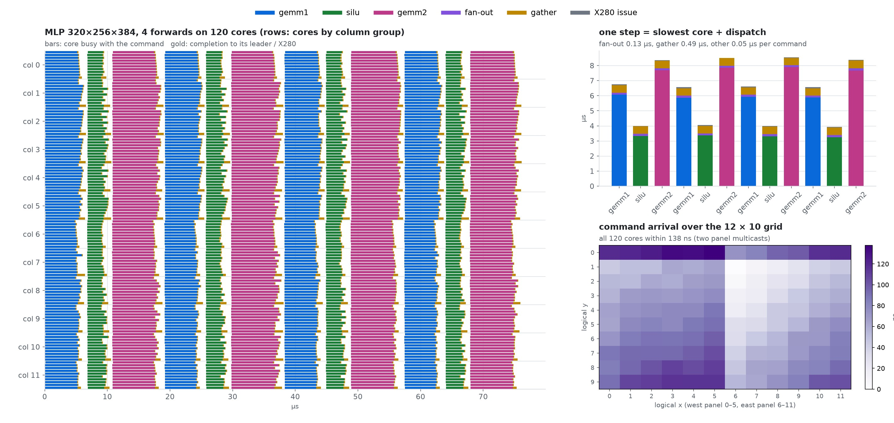
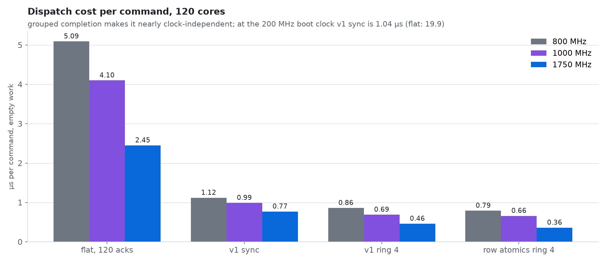
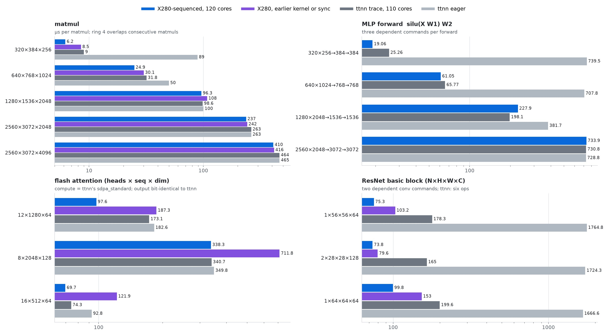
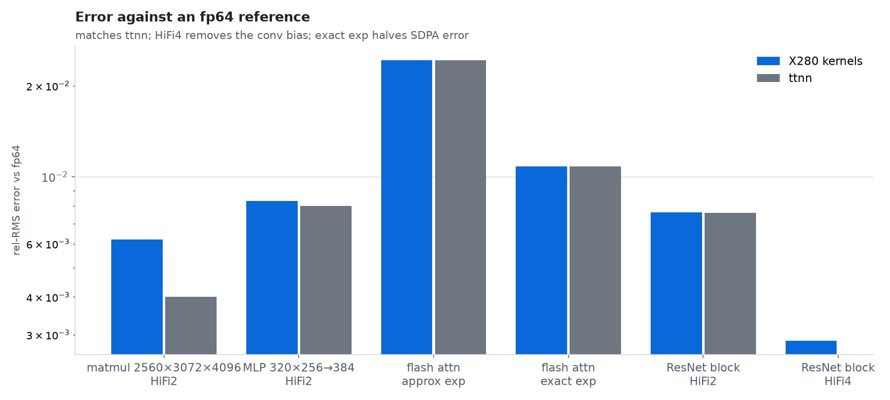
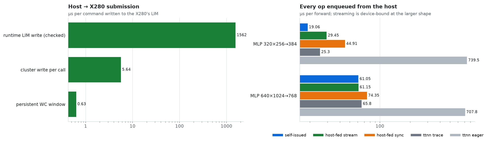
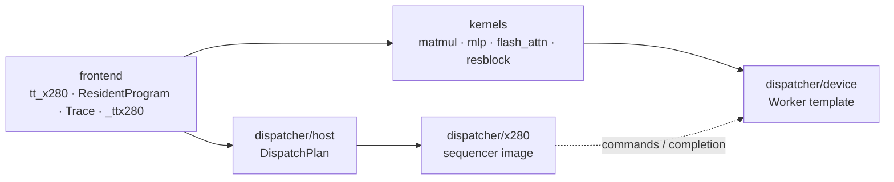

# tt-x280-dispatch


Resident Metalium kernels on **all 120 Tensix cores of a Tenstorrent Blackhole p150a**,
sequenced by the **X280 RISC-V cores inside the chip** instead of by the host and dispatch
cores. A program is launched once; after that every op is a sequence number the X280
multicasts into the cores' L1, and every core reports back through its column leader. A
dependent step costs 0.77 µs of dispatch, an independent one 0.46 µs, and the host can feed
commands one 4-byte store at a time.

Kernels stay ordinary Metalium reader / compute / writer kernels that loop over commands
(four template calls), and they are written, launched and checked from Python on ordinary
ttnn tensors. Matmul, an MLP forward, flash attention and a ResNet basic block run this way,
each checked against fp64.


**Contents:** [Highlights](#highlights) · [Install](#install) · [Quick start](#quick-start) ·
[How it works](#how-it-works) · [Measured](#measured) · [Findings](#findings) ·
[Repository layout](#repository-layout) · [Documentation](#documentation) ·
[Checks](#checks) · [Limits](#limits) · [License](#license)

## Highlights

- **120 cores, no dispatch cores, no host per op.** The X280 issues each command with one
  posted store per physical multicast panel; all 120 cores see it within 135 ns. A step
  between dependent ops costs 0.77 µs (0.46 µs with four independent commands in flight).
- **Faster than ttnn trace on small and medium work.** MLP forward 320×256→384→384 in
  19.1 µs against 25.3 (trace) and 740 (eager); flash attention 12×1280×64 in 97.6 µs
  against 173; a ResNet basic block 1×56×56×64 in 75 µs against 178; matmul
  2560×3072×4096 at 157 TFLOPS against 139.
- **Same numerics as ttnn.** Flash attention reuses ttnn's `sdpa_standard` compute and is
  bit-identical to `ttnn.transformer.scaled_dot_product_attention`. Every kernel reports
  rel-RMS, max-abs, mean bias and PCC against fp64.
- **Generic kernels.** Reader / compute / writer kernels with four template calls; ops chain
  through a per-command op table. K/V chunks are shared across a lane of up to 10 cores by
  multicast.
- **Eager-style streaming.** The host enqueues a command with one write-combining PCIe store
  (0.63 µs) and reads completion from pinned host memory. Host-fed MLP 640×1024→768→768
  streams at the device-bound rate (61.2 µs vs 61.1 self-issued).
- **A trace of every core.** `run(..., trace=True)` records when each core saw, finished and
  reported each command, for waterfalls like the one below.
- **Reliable.** 16 M+ dispatch commands without a failure after fixing the issues in
  [Findings](#findings).

## Install

Needs a tt-metal **v0.81.1** source tree with the experimental X280 runtime and ttnn, and a
p150a whose X280 LIM ECC is primed once (see the upstream X280 README).

```
git clone --branch v0.81.1 https://github.com/tenstorrent/tt-metal && cd tt-metal
./build_metal.sh --configure-only && cmake -B build -DTT_METAL_BUILD_X280=ON
X280_ALLOW_LIM_ECC_PRIME=1 TT_VISIBLE_DEVICES=1 build/test/tt_metal/x280/x280_prime_test && tt-smi -r 1

git clone https://github.com/KohakuBlueleaf/tt-x280-dispatch
tt-x280-dispatch/install.sh $PWD        # 3-line CMake hook, then builds from this repo
export TT_METAL_RUNTIME_ROOT=$PWD
export PYTHONPATH=$PWD/ttnn:$PWD:$PWD/tools:$PWD/build/ttx280:$PWD/../tt-x280-dispatch/src/frontend
```

`install.sh` adds an `include()` of [`cmake/tt_x280_dispatch.cmake`](cmake/tt_x280_dispatch.cmake)
to tt-metal's X280 CMakeLists ([patch](patches/tt-metal-v0.81.1.patch)) and builds the X280
images, the C++ hosts and the `_ttx280` Python module straight from this checkout.

## Quick start

The examples run in slow dispatch (the full 12×10 grid) on one card:

```
TT_VISIBLE_DEVICES=1 python -m tt_x280.examples.mlp --shape 320 256 384 [--host-fed] [--trace t.pt]
TT_VISIBLE_DEVICES=1 python -m tt_x280.examples.flash_attn --shape 12 1280 64
TT_VISIBLE_DEVICES=1 python -m tt_x280.examples.resblock --shape 1 56 56 64 [--fidelity HiFi4]
```

Each prints one record: µs per forward from the X280's clock, TFLOPS and the error
statistics against fp64. A resident program from Python:

```python
import ttnn, tt_x280

device = ttnn.open_mesh_device(ttnn.MeshShape(1, 1))
device.disable_and_clear_program_cache()       # the dispatch tag changes per run
plan = tt_x280.Runtime(device, pll_mhz=1750).plan(depth=1)  # 1: dependent ops

program = tt_x280.ResidentProgram(plan)         # adds the control CB on every core
program.add_cb(0, ttnn.bfloat16, 2048, 8)
program.add_kernel(f"{tt_x280.KERNEL_DIR}/mine/reader.cpp", cores, reader_config,
                   lambda x, y: [a.buffer_address(), n_cmds], accessor_args, dispatch=True)
program.add_kernel(f"{tt_x280.KERNEL_DIR}/mine/writer.cpp", cores, writer_config,
                   writer_args, dispatch=True)
program.add_kernel(f"{tt_x280.KERNEL_DIR}/mine/compute.cpp", cores, compute_config,
                   compute_args, compile_args)
ticks = program.run([a, out], n_cmds)           # ticks of the X280's 50 MHz clock
```

## How it works

### The chip

A p150a has 140 Tensix tiles, 120 usable on our cards: harvesting disables NOC0 columns 7
and 10. The L2CPU column 8 holds four X280 tiles (four RISC-V cores each); DRAM sits in
columns 0 and 9. The X280 reaches any tile through 2 MiB TLB windows, which can multicast.

| Piece | Where | Does |
|---|---|---|
| Sequencer | `src/dispatcher/x280/sequencer.c`, X280 hart 0, its LIM | takes command k, issues it, waits for completion, publishes the count |
| Panels | from the chip's NOC0 coordinates | two physically contiguous Tensix rectangles: logical x 0–5 and 6–11 |
| Command ring | control CB 8 in every core | slot k mod depth; the core's reader spins on its own L1 |
| Column groups | 12 columns of 10 cores | 9 members write their slot in the bottom core; it acks to the X280 |
| Host ring | 16 × 64 B in LIM, write-combining window | the host writes k; the X280 writes the done count to pinned host memory |

### One command

1. The X280 takes command k: its own counter, or a host ring slot that holds k.
2. With depth 1 it waits until command k − 1 completed everywhere (dependent ops); with
   depth 4 up to four commands are in flight.
3. It writes k into both panels with one posted multicast store each.
4. Every core's reader sees k, runs op `table[k]` with its compute and writer kernels, and
   the writer writes its outputs and then `tag << 16 | k` into its own 16-byte slot in its
   column leader.
5. A leader that sees all 9 slots at k writes k into its slot in the X280's LIM; the X280
   sweeps the 12 slots and goes to 1.

The trace below shows these steps on the real chip: a dependent step is the slowest core
plus about 0.6 µs (0.14 µs fan-out, 0.49 µs gather).

### A kernel

Device side, with [`ttx_dispatch.hpp`](src/dispatcher/device/ttx_dispatch.hpp):

```cpp
// reader: wait for each command, then read the inputs of its op
ttx::Worker worker(ttx::Args::read(arg_index));
worker.start();
for (uint32_t k = 1; k <= n_cmds; k++) {
    if (!worker.wait(k)) {
        return;
    }
    // ... read inputs of op (k - 1) % ops, push CBs ...
}

// writer: write outputs, then report completion
for (uint32_t k = 1; k <= n_cmds; k++) {
    // ... write outputs ...
    noc_async_write_barrier();
    worker.complete(k);
}
worker.flush_trace(n_cmds);
```

Compute kernels need nothing from the template. Ops chain through a fixed op table: the
MLP reader runs GEMM1, SiLU, GEMM2 for k mod 3 = 1, 2, 0. See
[writing kernels](docs/writing-kernels.md).

## Measured

Every number comes from `src/frontend/tt_x280/examples` or `bench/`, on two p150a cards
(FW 19.13.1, KMD 2.12.0), X280 PLL4 at 1750 MHz, bf16 with fp32 accumulation, HiFi2
unless stated. X280 rows use 120 cores in slow dispatch; ttnn v0.81.1 rows use 110 cores
in fast dispatch. Tables: [docs/measurements](docs/measurements).

### The machine



Four MLP forwards (12 dependent commands) as recorded by every core. Commands start on all
120 cores within 135 ns, the east panel first; a step is the slowest core plus 0.14 µs of
fan-out and 0.49 µs of gather. Rows 1–9 of a column finish together with their leader.

### Dispatch



Empty work, 10⁴–10⁶ commands per point. One ack per core makes the X280 the bottleneck
and scales with its clock; column groups cut the messages it receives from 120 to 12 and
make the cost nearly clock-independent. At the 200 MHz boot clock v1 is 1.04 µs per
dependent step. All models: [dispatch models](docs/models.md).

### Kernels



| Kernel | X280 | ttnn trace | ttnn eager | rel-RMS vs fp64 |
|---|---|---|---|---|
| matmul 320×384×256 (ring 4) | **6.2** | 9.0 | 89 | 4.5e-3 |
| matmul 2560×3072×4096 (ring 4) | **410** | 464 | 465 | 6.2e-3 |
| MLP 320×256→384→384 | **19.1** | 25.3 | 740 | 8.3e-3 |
| MLP 1280×2048→1536→1536 | 228 | **198** | 382 | 8.9e-3 |
| flash attention 12×1280×64 | **97.6** | 173 | 183 | 2.4e-2 (= ttnn) |
| flash attention 8×2048×128 | **338** | 341 | 350 | 2.4e-2 (= ttnn) |
| flash attention 16×512×64, chunks 64 | **69.7** | 74.3 | 92.8 | 2.6e-2 (= ttnn) |
| ResNet block 1×56×56×64 | **75.3** | 178 | 1765 | 7.6e-3 (ttnn 7.6e-3) |
| ResNet block 2×28×28×128 | **73.8** | 165 | 1724 | 7.6e-3 (ttnn 8.1e-3) |
| ResNet block 1×64×64×64 | **99.8** | 200 | 1667 | 7.7e-3 (ttnn 7.8e-3) |

µs per op or forward. Flash attention went from 187 to 97.6 µs (12×1280×64) and from 712 to
338 µs (8×2048×128) when its reader started sharing K/V: each lane's first core reads a
chunk from DRAM once and multicasts it to the lane. The ResNet block went from 103 to
75 µs (1×56×56×64) when its reader stopped gathering each tap from DRAM: it reads an
output tile's input halo once (146 pixel rows instead of 288) and builds the 9 taps with
local L1 copies. At 1280-wide the MLP loses to our example-grade matmul kernel, not to
dispatch.

### Numerics



Fidelity shows as a bias at moderate K: a 3×3 conv (K = 576) at HiFi2 runs −0.25 % of the
output RMS low, in ttnn's conv2d as in ours; HiFi4 removes it (rel-RMS 2.9e-3, the bf16
floor for the intermediate) for 1–7 % time. SDPA's approximate exp doubles the error
(2.4e-2 against 1.1e-2) for 1.5× speed in ours, 3.1× in ttnn's.

### From the host



The runtime's checked LIM write inspects the whole X280 state per call; a cluster write sets
up a TLB per call; a persistent write-combining window is one store and an `sfence`. The
X280 writes its done count into pinned host memory, so polling never reads over PCIe
(a host read of LIM costs 23–42 µs).

## Findings

| Finding | Detail |
|---|---|
| Multicast rectangles must be physically Tensix-only | on a harvested chip translated x 7 is NOC0 x 11: a "west" rectangle over translated 1–7 covered the harvested, L2CPU and DRAM columns and lost or zeroed a command every 10⁵–10⁶; panels from NOC0 coordinates: 0 in 16 M+ |
| L1 survives between processes | a handshake that trusts L1 needs a per-process random tag |
| Tensix atomics are reliable | 0 lost in 170 M `noc_semaphore_inc` from 119 cores into one semaphore |
| tt-metal's fast dispatch has the same shape | one non-posted multicast per go signal from a dispatch Tensix, completion counted in a stream register; v1 moves the sequencer to the X280 and frees the dispatch column |

[Findings in full](docs/findings.md).

## Repository layout



```
src/
  dispatcher/
    x280/          sequencer.c (the X280 image), experiments/ (earlier images)
    device/        ttx_dispatch.hpp: Worker, the Tensix side of the protocol
    host/          ttx_dispatch_host.hpp: DispatchPlan, panels, groups, host ring
  kernels/         protocol/, matmul/, mlp/, flash_attn/, resblock/: reader, compute, writer
  frontend/
    tt_x280/       ResidentProgram, layout, stats, trace, examples/
    native/        _ttx280 nanobind module (Runtime, Plan) on ttnn's MeshDevice
  hosts/           C++ hosts: bench (protocol, all models), matmul, mlp
cmake/             the build, included from tt-metal
patches/           the 3-line tt-metal hook
bench/             ttnn baselines, sweeps, run_examples.sh
scripts/docs/      results.py, plots.py, diagrams.py: this README's figures
docs/              the protocol, models, findings, kernel guide; measurements/, assets/
tests/             offline tests
```

## Documentation

| Where | Read it for |
|---|---|
| [dispatch model](docs/dispatch-model.md) | the v1 protocol: roles, command and completion paths, start-up, rules |
| [dispatch models](docs/models.md) | every model we built and what it cost |
| [findings](docs/findings.md) | the root causes behind the rules |
| [writing kernels](docs/writing-kernels.md) | the template, the Python front-end, op chaining, debugging |
| [measurements](docs/measurements) | the tables and data behind every figure |

## Checks

```
python -m pytest tests                          # offline: layout, trace, stats
bench/run_examples.sh 1 runs/                   # every example on card 1, with traces
python scripts/docs/plots.py docs/assets        # measured figures
python scripts/docs/diagrams.py docs/assets     # drawn figures
```

## Limits

- Measured on two p150a cards with the same harvesting; other patterns are handled by the
  plan's panel derivation but untested.
- Slow dispatch and exclusive use of the card: the X280 runtime, PLL4 and a resident
  program own it while they run. A hung resident kernel needs `tt-smi -r` and a PCIe retrain.
- The resident program disables ttnn's program cache (the dispatch tag changes per run).
- Watcher cannot run while the X280 runtime is open; debug kernels without it first.
- Example kernels are ours or reuse ttnn compute; they are not tuned like ttnn's own ops.
- Known issue: the ResNet-block example does not complete with `--forwards 8` (16
  commands) while the default 32 forwards run correctly, warm or cold kernel cache; the
  MLP and flash attention run at any count. Not yet root-caused.

## Contributing

Open an issue first. Conventions: black (defaults) and the repository `.clang-format`, a
blank line between logic blocks, a one- or two-line comment saying what a block does when
the code does not, a docstring for every file, class and function. Run the checks before a
pull request.

## License

Apache-2.0.
